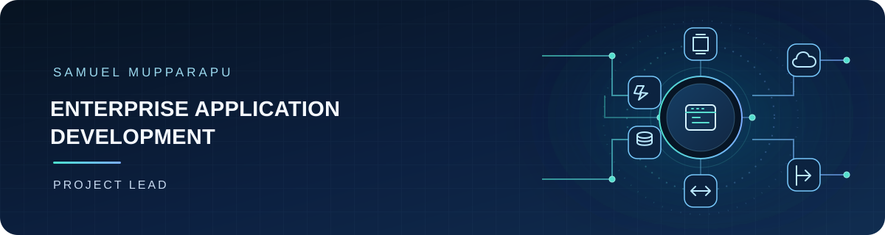

  

## Connecting technology to real-world solutions

I approach application delivery as one connected lifecycle: understand the need, shape the solution, integrate the right systems and data, build securely, and support reliable delivery. My experience spans the layers that make this work together:

- **Application and integration:** C#, .NET / ASP.NET Core, Python, REST APIs, microservices, and Azure Functions.
- **Cloud and data foundations:** Microsoft Azure, Azure SQL, Cosmos DB, PostgreSQL, Azure Data Factory, Data Lake, and Databricks.
- **AI-enabled capabilities:** Azure OpenAI, Azure Cognitive Search, Databricks AI Search, Genie, RAG, MCP, and multi-agent workflows.
- **Engineering and delivery:** Solution architecture, identity and governance, Azure DevOps and GitHub CI/CD, monitoring, reliability, and performance optimization.

The goal is to connect these capabilities into cohesive applications—not isolated technologies—with attention to secure access, useful workflows, maintainability, and outcomes that matter to users and stakeholders.

## Certifications

- [Databricks Certified Context Engineer Associate](https://www.databricks.com/learn/certification/context-engineer-associate)
- [Microsoft Certified: Azure Solutions Architect Expert (AZ-305)](https://learn.microsoft.com/en-us/credentials/certifications/azure-solutions-architect/)
- [Microsoft Certified: Azure Developer Associate (AZ-204)](https://learn.microsoft.com/en-us/credentials/certifications/azure-developer/)
- [Microsoft Certified: Azure AI Engineer Associate (AI-102)](https://learn.microsoft.com/en-us/credentials/certifications/azure-ai-engineer/)
- [Microsoft Certified: Azure Administrator Associate (AZ-104)](https://learn.microsoft.com/en-us/credentials/certifications/azure-administrator/)
- [Microsoft Certified: Azure Database Administrator Associate (DP-300)](https://learn.microsoft.com/en-us/credentials/certifications/azure-database-administrator-associate/)
- [Microsoft Certified: Azure Data Engineer Associate (DP-203)](https://learn.microsoft.com/en-us/credentials/certifications/azure-data-engineer/)
- [Microsoft Certified: DevOps Engineer Expert (AZ-400)](https://learn.microsoft.com/en-us/credentials/certifications/devops-engineer/)

---

Integrated engineering · Practical solutions · Reliable delivery

