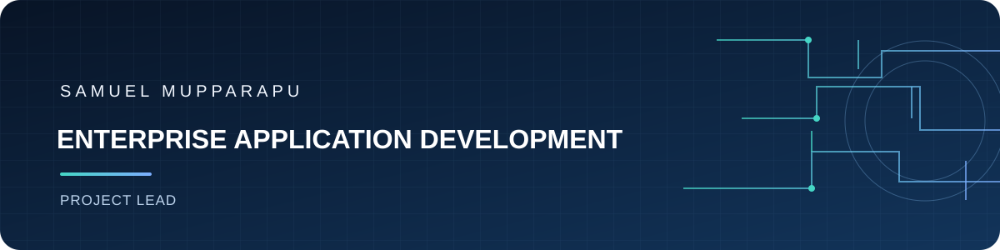

  

<h1 align="center">Samuel Mupparapu</h1>

<strong>Project Lead | Enterprise Application Development</strong>

London, United Kingdom

## Professional profile

Project Lead and technology professional focused on building enterprise applications that bring business workflows, APIs, cloud services, data platforms, and AI capabilities together. I combine hands-on engineering across Azure, .NET, Python, and Databricks with solution design, security, governance, and delivery leadership to develop integrated applications for practical, real-world needs.

## Connecting technology to real-world solutions

I approach application delivery as one connected lifecycle: understand the need, shape the solution, integrate the right systems and data, build securely, and support reliable delivery. My experience spans the layers that make this work together:

- **Application and integration:** C#, .NET / ASP.NET Core, Python, REST APIs, microservices, and Azure Functions.
- **Cloud and data foundations:** Microsoft Azure, Azure SQL, Cosmos DB, PostgreSQL, Azure Data Factory, Data Lake, and Databricks.
- **AI-enabled capabilities:** Azure OpenAI, Azure Cognitive Search, Databricks AI Search, Genie, RAG, MCP, and multi-agent workflows.
- **Engineering and delivery:** Solution architecture, identity and governance, Azure DevOps and GitHub CI/CD, monitoring, reliability, and performance optimization.

The goal is to connect these capabilities into cohesive applications—not isolated technologies—with attention to secure access, useful workflows, maintainability, and outcomes that matter to users and stakeholders.

## Experience

**HCLTech — Project Lead**  
*September 2022 – April 2026 | Bengaluru, India*  
*World Bank Group engagements (IBRD, IDA, IFC, and MIGA)*

- Designed and delivered secure data and application solutions using Azure SQL, Cosmos DB, Azure Data Lake, and Databricks.
- Developed backend services and REST APIs with C#, ASP.NET Core, .NET, and Python; integrated Azure Functions and Data Factory.
- Integrated Azure OpenAI, Azure Cognitive Search, Databricks AI Search, Genie, and MCP to support contextual retrieval and AI-enabled workflows.
- Contributed to solution architecture, identity and governance, monitoring, performance optimization, and high availability / disaster recovery planning.
- Supported automated delivery through Azure DevOps and GitHub CI/CD, alongside code reviews, debugging, and cross-functional collaboration.

## Certifications

- Databricks Certified Context Engineer Associate
- Microsoft Certified: Azure Solutions Architect Expert (AZ-305)
- Microsoft Certified: Azure Developer Associate (AZ-204)
- Microsoft Certified: Azure AI Engineer Associate (AI-102)
- Microsoft Certified: Azure Administrator Associate (AZ-104)
- Microsoft Certified: Azure Database Administrator Associate (DP-300)
- Microsoft Certified: Azure Data Engineer Associate (DP-203)
- Microsoft Certified: DevOps Engineer Expert (AZ-400)

---

Integrated engineering · Practical solutions · Reliable delivery
